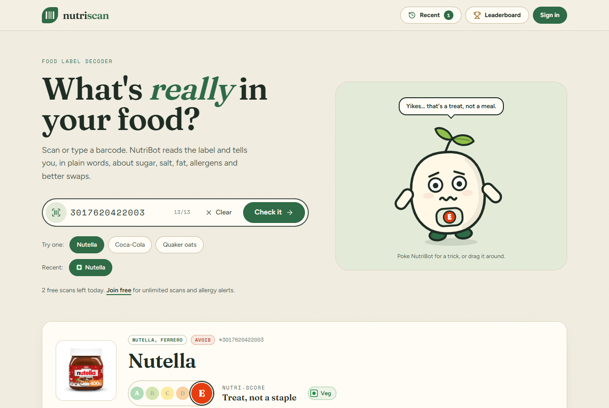
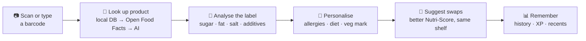

# 🌱 NutriScan: Project Overview

**What NutriScan is, the problem it solves, and how we solved the hard parts.**

[← Back to README](../../README.md) · [Tech stack →](02-TECH-STACK.md)

---

## Contents

- [The one-line pitch](#-the-one-line-pitch)
- [The problem](#-the-problem)
- [Who it is for](#-who-it-is-for)
- [Our solution](#-our-solution)
- [Feature tour](#-feature-tour)
- [How we overcame the hard problems](#-how-we-overcame-the-hard-problems)
- [Current status and limits](#-current-status-and-limits)
- [Roadmap](#-roadmap)

---

## 💡 The one-line pitch

> Scan a packaged food's barcode and NutriScan tells you, in plain words, how much sugar, salt and fat it has, what's in it, whether it's veg or non-veg, whether it clashes with **your** allergies or diet, and which better-rated products you could buy instead.

  

---

## 🧩 The problem

Food labels are written for regulators, not for shoppers. Standing in a shop aisle, most people cannot answer a simple question: *"Is this OK for me?"*

| Pain point | What it looks like in real life |
|:--|:--|
| **Numbers without meaning** | "56.3 g sugar per 100 g": is that a lot? (It's more than a whole day's WHO limit in 100 g.) |
| **Foreign-language labels** | Imported products list ingredients like *"sucre, huile de palme, lactosérum"*. |
| **Hidden ingredients** | Palm oil hides as *"vegetable fat (palm)"*; additives hide as E-numbers such as `E322`, `E150d`. |
| **Allergies and diets** | A vegan or a person with a dairy allergy has to read every line, every time. |
| **Veg / non-veg** | In India the green/brown mark matters, but imported products often don't carry it. |
| **No easy comparison** | Even when you know a product is unhealthy, finding a better one on the same shelf is guesswork. |

> [!NOTE]
> The data to answer these questions already exists in the open [Open Food Facts](https://world.openfoodfacts.org) database (millions of products). The missing piece is a **friendly, trustworthy layer** that turns that data into an answer.

---

## 🎯 Who it is for

| Persona | What they need from NutriScan |
|:--|:--|
| 🛒 **Everyday shopper** | A quick "good / okay / avoid" verdict and the reason, in one glance. |
| 🥜 **People with allergies** | An alert when the label mentions something they declared, e.g. *Contains Dairy*. |
| 🌿 **Diet followers** (vegan, vegetarian, halal, keto…) | A warning when a product doesn't fit their diet. |
| 🇮🇳 **Indian shoppers** | A clear **Veg / Non-veg** mark, even on imported products. |
| 🎮 **Curious scouts** | Points (XP) for being the first to scan a product, and a leaderboard. |

---

## ✅ Our solution

NutriScan is a full-stack web app:

- **Frontend:** a Next.js 16 / React 19 site with a friendly mascot, *NutriBot*.
- **Backend:** a Spring Boot 4 API that looks up products, analyses them and stores user data.

**Design principles we followed**

1. **Plain words first.** Every number is explained ("about 14 teaspoons", "27% of a 2,000 kcal day").
2. **Never invent facts.** The analysis is built from the label data. When the AI is used, it only rewrites those facts, and the UI labels it **"AI summary"**.
3. **Trust, but say so.** Keyword-based checks (allergies, veg mark) can flag a problem but never "prove" safety. The UI always says *"check the pack"*.
4. **Fast and forgiving.** Guests can try it without an account; errors are explained, never shown as blank screens.

---

## ✨ Feature tour

<b>🔎 Scanning and lookup</b>

- Type a barcode (EAN-8, UPC-A, EAN-13) or scan it with the **camera** or an **uploaded photo**.
- **"Try one"** sample buttons (Nutella, Coca-Cola, Quaker oats) show a result in one tap.
- **Clear** button resets the page for the next search.
- **Recent searches**: the last 5 as chips on the home page; the full list (up to 30) in the nav bar's **Recent** panel, filterable by **Veg / Non-veg**.
- Lookup order: **local database → Open Food Facts → AI estimate** (the AI is only asked about valid barcodes and its answers are clearly labelled).

<b>🧠 Analysis ("NutriBot's take")</b>

- A short plain-English **verdict**: *Clean*, *Moderate* or *Avoid*.
- **Watch out** and **The good stuff** lists: high sugar/fat/salt, energy density, palm oil, sweeteners, additives (E-numbers), allergens, protein.
- Uses UK FSA traffic-light thresholds, with separate limits for **drinks** (per 100 ml).
- Optional **AI summary** (OpenRouter) when an API key is configured, cached per product.

<b>🙋 Personal alerts and veg mark</b>

- Signed-in users get alerts from their profile: **allergies** (peanuts, gluten, dairy, soy, tree nuts, eggs, shellfish), **diet** (vegan, vegetarian, pescatarian, halal, keto) and **medical notes** (diabetes, blood pressure, coeliac).
- **Veg / Non-veg** mark in the Indian (FSSAI) sense: meat, fish, seafood, eggs and gelatine are non-veg; milk and honey are veg.

<b>🔁 Better swaps</b>

- Up to 4 popular products **from the same category with a better Nutri-Score** (e.g. Coke Zero for Coca-Cola), from the Open Food Facts search service.
- Tap a swap to check it in-app.

<b>👤 Accounts, history and gamification</b>

- Register / sign in with username **or** email; guest scans are imported into your history on sign-up.
- **Dashboard** with scout level, XP, discoveries and a scan log (verdict + veg mark).
- **Profile** with diet, allergies, medical notes, username (changeable every 20 days) and password.
- **+10 XP** for the first-ever scan of a verified product; public **leaderboard** (top 10).
- Guests get **5 free scans per day**.

<b>🤖 NutriBot, the mascot</b>

- Eyes follow your cursor, blinks, falls asleep after 30 s idle.
- Poke it for tricks (wave, giggle, spin, wink, sneeze, dance, jump); drag it around; works with the keyboard.
- Reacts to results: happy dance for A/B, a worried sweat drop for D/E, a "?" when a product isn't found.

---

## 🔨 How we overcame the hard problems

This section records real problems found while building and testing NutriScan, and how each was solved. It's the most useful part for anyone maintaining the code.

### Product and data problems

| # | Problem | How we solved it | Where |
|:-:|:--|:--|:--|
| 1 | Labels from Open Food Facts were often **French** ("lait, fruits à coque, soja"). | Prefer `ingredients_text_en`; build allergens from language-neutral `allergens_tags` (`en:milk` → "Milk"). Old rows **self-repair** the first time their analysis is opened. | `ProductMapper`, `ProductInsightService` |
| 2 | Category data contained junk like `en:Produits à tartiner`, so alternative searches found nothing. | Accept only real taxonomy slugs (`en:[a-z0-9-]+`) and widen to the parent category when a category has too few results. | `OpenFoodFactsProductDto`, `ProductInsightService` |
| 3 | The classic product search endpoint (`/cgi/search.pl`) was returning **"temporarily unavailable"**. | Switched to Open Food Facts' **search-a-licious** service (`search.openfoodfacts.org`), which is fast (~0.5 s) and supports category + grade queries. | `OpenFoodFactsService` |
| 4 | The AI fallback would happily **invent** a product for any number, and users could farm XP from it. | The AI is only asked about barcodes with a valid **GS1 check digit**; AI products are tagged `AI_ESTIMATE`, shown with a warning, and earn **no XP**. | `Barcodes`, `AiProductProvider`, `ProductService` |
| 5 | Palm oil appears as "vegetable fat **(palm)**", "huile de palm**e**", "aceite de palm**a**". | One whole-word regex that matches all of them but not "palmitate". | `ProductAnalyzer` |
| 6 | Keyword checks raised false alarms: "peanut **butter**" ≠ dairy, "**egg**plant" ≠ egg, "**cod**ium" ≠ fish. | Rewrite look-alike phrases before matching (keeping the part that still matters), whole-word matching, ignore "may contain traces of…". | `PersonalAlertChecker`, `VegClassifier` |
| 7 | Drinks were judged with food thresholds (cola looked "fine"). | Detect beverages from categories and apply the FSA **per 100 ml** limits. | `ProductAnalyzer` |

### Engineering problems

| # | Problem | How we solved it | Where |
|:-:|:--|:--|:--|
| 8 | Every validation error, bad JSON or missing login came back as an **empty 403**, so the UI could never show a real message. | One `@RestControllerAdvice` returning a consistent JSON error, plus JSON 401/403 handlers in Spring Security and `/error` permitted. | `GlobalExceptionHandler`, `JsonSecurityErrorHandler` |
| 9 | A fake `Authorization: Bearer garbage` header **bypassed** the 5-scan guest limit; so did a fake `X-Forwarded-For`. | "Guest" now means *no valid token*; the client IP comes from the socket (proxy support via `server.forward-headers-strategy`). | `ProductController`, `ClientIpUtil` |
| 10 | If **Redis** was down, every guest scan crashed with a 500. | The rate limiter falls back to an in-memory Caffeine counter and stops retrying Redis for 30 s. | `RateLimiterService` |
| 11 | Calls to Open Food Facts / OpenRouter had **no timeout** and could hang a server thread forever. | JDK HTTP client with connect/read timeouts on every outbound client. | `RestClientConfig` |
| 12 | Changing your **email** logged you out on the next request (the token's subject was the old email). | The profile update returns a **fresh JWT**; the frontend stores it. | `UserService`, `ProfileClient.tsx` |
| 13 | The demo user was **deleted and recreated** on every start, which crashed startup once it had scan history. | Create-if-missing only, off by default, and configured through env vars (no credentials in code). | `DataInitializer` |
| 14 | The dashboard called an endpoint that didn't exist; "history" was treated as a barcode. | Added `GET /users/me/scans` with a computed verdict per scan. | `UserController` |
| 15 | Two users discovering at the same time could lose XP (read-modify-write). | Atomic SQL `UPDATE … SET score = score + 10`. | `UserRepository.awardDiscovery` |
| 16 | The camera scan button did nothing (the modal was never rendered). | Rendered the modal and guarded the decoder against firing twice. | `page.tsx`, `BarcodeScannerModal` |
| 17 | Next.js 16 dev overlay error on gated pages ("instant navigation… dropped segment"). | Split each gated page into a server `page.tsx` (with `export const instant = false`) and a client component. | `app/dashboard`, `app/profile` |

> [!TIP]
> Most of the backend fixes above (1, 2, 4–10, 12, 14, 15) are pinned by the backend test suite (61 tests). The frontend fixes (16, 17) were verified with browser runs. See [Tech stack → Testing](02-TECH-STACK.md#-testing).

---

## 📌 Current status and limits

> [!IMPORTANT]
> NutriScan is a **working prototype**: all features work end-to-end locally and are covered by tests, but it has not been deployed to production.

- **Keyword-based safety checks.** Allergy, diet and veg/non-veg detection read the label text. They can miss things if the label data is incomplete; the UI always says to check the pack.
- **Data quality depends on Open Food Facts.** Some product names in swaps are in French or Spanish because that's how they are listed.
- **AI is optional.** Without `OPENROUTER_API_KEY`, the AI product fallback and AI summaries are switched off; the rule-based analysis still works.
- **Recent searches are per device.** They live in the browser (not the account) and are cleared on sign-out.
- **Unused leftovers.** `OnboardingModal.tsx`, `ScannerVisualizer3D.tsx` and a few npm packages are not used by any screen (listed in [Tech stack](02-TECH-STACK.md#-installed-but-not-used)).

---

## 🧭 Roadmap

- [x] Barcode lookup with Open Food Facts + AI fallback
- [x] Rule-based analysis, personal alerts, veg mark
- [x] Better-rated swaps
- [x] Eco redesign + NutriBot mascot
- [x] Recent searches with veg filters
- [x] Dockerfile + Render Blueprint, verified locally with free-tier limits
- [x] Production database configured for Neon (environment variables only)
- [x] Pushed to GitHub: [silent-coder-dev/nutriscan](https://github.com/silent-coder-dev/nutriscan)
- [ ] Deploy on Render (see [LEARN.md → Part G](LEARN.md#part-g-deployment-render-pe-free-hosting))
- [ ] Use Open Food Facts' `ingredients_analysis_tags` to double-check the veg mark
- [ ] Store recent searches in the account so they sync across devices
- [ ] Add a frontend test suite (Playwright) to the repository
- [ ] Remove unused packages and components

---

[← Back to README](../../README.md) · [Tech stack →](02-TECH-STACK.md)

