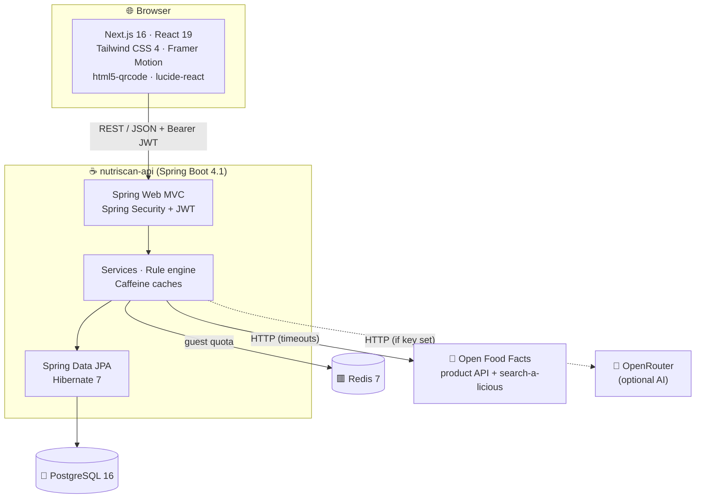

<div align="center">

# 🧰 NutriScan: Tech Stack

**Every technology in the frontend, backend, data layer and tooling: what version, why it was chosen, and where it is used.**


<br>


[← Overview](01-PROJECT-OVERVIEW.md) · [README](../../README.md) · [Design system →](03-DESIGN-SYSTEM.md)

</div>

---

## Contents

- [At a glance](#-at-a-glance)
- [Frontend](#-frontend)
- [Backend](#-backend)
- [Data and infrastructure](#-data-and-infrastructure)
- [External services](#-external-services)
- [Testing](#-testing)
- [Developer tooling](#-developer-tooling)
- [Installed but not used](#-installed-but-not-used)
- [Why these choices](#-why-these-choices)

---

## 🔭 At a glance



| Layer | Main technologies |
|:--|:--|
| **Frontend** | Next.js 16.4 (App Router, Turbopack), React 19.3, TypeScript 5.9, Tailwind CSS 4.3, Framer Motion 14.1, lucide-react 1.55, html5-qrcode 2.3.8 |
| **Backend** | Java 21 (runs on JDK 25 locally), Spring Boot 4.1.1, Spring Framework 7.0.9, Spring Security 7.1.1, Spring Data JPA 4.1.1, Hibernate ORM 7.4.5, Jackson 3.1, JJWT 0.11.5, jBCrypt 0.4 |
| **Data** | PostgreSQL 16 (Docker), Redis 7 (Docker), Caffeine 3.2 in-memory caches, HikariCP 7 connection pool |
| **External** | Open Food Facts product API v2, Open Food Facts search-a-licious, OpenRouter chat completions (optional) |
| **Testing** | JUnit 6, Mockito 5, AssertJ 3, Spring MockMvc (backend); ESLint 9 + TypeScript strict (frontend) |

---

## 💻 Frontend

> Folder: `nutriscan-web/` · Package manager: **npm** · Node.js **20.9+** (developed on 20.18)

### Core framework

| Technology | Version | Why we use it | Where |
|:--|:--|:--|:--|
| [**Next.js**](https://nextjs.org) | `16.4.0` | App Router file-based routing, Turbopack dev server, `next/font` self-hosted fonts, `next/og` image generation, static prerendering. | `app/` |
| [**React**](https://react.dev) | `19.3.0` | UI library. We use hooks heavily, including `useSyncExternalStore` for the session and recent-search stores. | everywhere |
| [**TypeScript**](https://www.typescriptlang.org) | `5.9.3` | `strict` mode; shared types in `types/product.ts` and `lib/api.ts`. | `*.ts(x)` |

**Next.js features switched on** (`next.config.ts`):

| Option | Value | Effect |
|:--|:--|:--|
| `cacheComponents` | `true` | Component-level caching and Partial Prerendering. |
| `partialPrefetching` | `true` | Prefetches one reusable "app shell" per route. Required alongside `cacheComponents` in 16.x. |
| `turbopack.rules` | `*.css → @tailwindcss/turbopack` | Runs Tailwind v4 through Turbopack. |

> [!NOTE]
> The dashboard and profile pages export `instant = false` from their server `page.tsx`. Their content is rendered only after the browser-side session check, so instant-navigation validation can't see it.

### Styling and motion

| Technology | Version | Why | Where |
|:--|:--|:--|:--|
| [**Tailwind CSS**](https://tailwindcss.com) | `4.3.3` | Utility-first CSS with the v4 `@theme` design tokens (colours, fonts) defined in CSS, plus a small set of component classes (`.panel`, `.btn-primary`, `.chip`…). | `app/globals.css` |
| [**@tailwindcss/turbopack**](https://www.npmjs.com/package/@tailwindcss/turbopack) | `4.3.3` | Tailwind loader for Turbopack. | `next.config.ts` |
| [**Framer Motion**](https://motion.dev) | `14.1.0` | Spring physics, keyframes, drag, `AnimatePresence` exits, `useReducedMotion`. Powers NutriBot and page transitions. | `NutriBot.tsx`, `ProductCard.tsx`, `HealthMeter.tsx`, modals |

### Feature libraries

| Technology | Version | Why | Where |
|:--|:--|:--|:--|
| [**html5-qrcode**](https://github.com/mebjas/html5-qrcode) | `2.3.8` | Reads EAN-13, EAN-8, UPC-A, UPC-E and Code-128 from the **camera** or an **uploaded photo**, entirely in the browser. | `BarcodeScannerModal.tsx` |
| [**lucide-react**](https://lucide.dev) | `1.55.0` | Clean, consistent line icons (37 used). Full list in the [design system](03-DESIGN-SYSTEM.md#-icons). | all UI |

### Frontend architecture choices (no extra libraries)

| Need | How we solved it *without* adding a dependency |
|:--|:--|
| HTTP client | A small `apiRequest()` wrapper over `fetch` with typed errors (`ApiError`), auth header and 401 auto sign-out (`lib/api.ts`). |
| Global state | Two tiny stores on `localStorage` + `useSyncExternalStore`: **session** (`lib/auth.ts`) and **recent searches** (`lib/recent.ts`). No Redux/Zustand needed. |
| Forms & validation | Controlled inputs + shared rules mirrored from the backend (`lib/validation.ts` ↔ `ValidationRules.java`). |
| Route protection | `AuthGuard` client component in the dashboard/profile layouts. |

---

## ☕ Backend

> Folder: `nutriscan-api/nutriscan-api/` · Build: **Maven 3.9.16** (wrapper `mvnw`) · Language level **Java 21**

### Spring platform

| Technology | Version | Why | Where |
|:--|:--|:--|:--|
| [**Spring Boot**](https://spring.io/projects/spring-boot) | `4.1.1` | Auto-configuration, embedded Tomcat, production defaults. | whole app |
| **Spring Framework** (Web MVC) | `7.0.9` | REST controllers, `RestClient` for outbound HTTP, `@RestControllerAdvice` error handling. | `controller/`, `config/RestClientConfig` |
| **Embedded Tomcat** | `11.0.24` | Servlet container. | runtime |
| [**Spring Security**](https://spring.io/projects/spring-security) | `7.1.1` | Stateless security filter chain, CORS, JSON 401/403 handlers. | `config/SecurityConfig`, `security/` |
| **Spring Data JPA** | `4.1.1` | Repositories, derived queries, JPQL, atomic `@Modifying` updates, `Pageable` limits. | `repository/` |
| **Hibernate ORM** | `7.4.5.Final` | JPA provider; `ddl-auto=update` evolves the schema in development. | `entity/` |
| **Hibernate Validator** (Jakarta Bean Validation) | `9.1.3.Final` | `@NotBlank`, `@Pattern`, `@Size`, `@Email` on request DTOs. | `dto/` |
| **Spring Data Redis** + **Lettuce** | `4.1.1` / `7.5.2` | Guest rate-limit counters with TTL. | `service/RateLimiterService` |
| **Spring Boot Actuator** | `4.1.1` | `/actuator/health`, `/actuator/info`. | runtime |
| **Spring Boot DevTools** | `4.1.1` | Auto-restart in development. | dev only |

### Libraries

| Library | Version | Why | Where |
|:--|:--|:--|:--|
| **Jackson** (`tools.jackson`) | `3.1.5` | JSON (Spring Boot 4 uses Jackson 3); parsing AI responses. | `parser/AiResponseParser` |
| [**JJWT**](https://github.com/jwtk/jjwt) | `0.11.5` | Sign/verify HS256 JSON Web Tokens. | `util/JwtUtil` |
| [**jBCrypt**](https://www.mindrot.org/projects/jBCrypt/) | `0.4` | Password hashing (cost 10). | `config/PasswordEncoder` |
| [**Caffeine**](https://github.com/ben-manes/caffeine) | `3.2.4` | Bounded TTL caches: AI summaries, alternatives, category lookups, and the in-memory rate-limit fallback. | `service/ProductInsightService`, `RateLimiterService` |
| **Apache Commons Text** | `1.10.0` | Un-escape HTML entities in ingredient text. | `service/IngredientSimplifierService` |
| **PostgreSQL JDBC** | `42.7.13` | Database driver. | runtime |
| **HikariCP** | `7.0.2` | Connection pool (5–20 connections, 5 s timeout). | `application.properties` |
| [**Lombok**](https://projectlombok.org) | `1.18.46` | `@Builder`, `@Getter/@Setter`, `@RequiredArgsConstructor`, `@Slf4j`. | most classes |

### Backend patterns used

| Pattern | Where | Why |
|:--|:--|:--|
| **Chain of Responsibility** | `ProductProvider` → `OpenFoodFactsProductProvider` (priority 1), `AiProductProvider` (priority 2) | Try sources in order; easy to add a new source. |
| **DTO + Mapper** | `dto/`, `mapper/` | Never expose entities; normalise external data (Nutri-Score, allergens, categories). |
| **Global exception handler** | `exception/GlobalExceptionHandler` | One JSON error shape for every failure. |
| **Pure rule engines** | `ProductAnalyzer`, `PersonalAlertChecker`, `VegClassifier`, `HealthVerdictCalculator` | Static, side-effect-free, easy to unit test. |
| **Graceful degradation** | `RateLimiterService` (Redis → memory), `OpenRouterService` (disabled without key) | The app keeps working when optional parts are down. |

---

## 💾 Data and infrastructure

| Component | Version | Runs as | Purpose |
|:--|:--|:--|:--|
| **PostgreSQL** | `16-alpine` locally · **Neon** serverless in production | Docker container `nutriscan-postgres` (`docker-compose.yml`) / Neon (pooled endpoint, SSL) | Users, products, scan history. |
| **Redis** | `7-alpine` | Docker container `nutriscan-redis` | Guest scan counters (`rate:guest:<ip>`, 24 h TTL). |
| **Caffeine** | in-process | inside the API | Caches with 6 h TTL; rate-limit fallback. |
| **Browser `localStorage`** | n/a | the user's browser | JWT + profile snapshot, guest barcodes, recent searches. |

> [!WARNING]
> `docker-compose.yml` currently defines **only PostgreSQL**. Start Redis with:
> ```bash
> docker run -d --name nutriscan-redis -p 6379:6379 redis:7-alpine
> ```
> If Redis is missing the API still works: the guest limit falls back to memory.

---

## 🌍 External services

| Service | Endpoint | Used for | Auth |
|:--|:--|:--|:--|
| **Open Food Facts: product API v2** | `https://world.openfoodfacts.org/api/v2/product/{barcode}.json?fields=…` | Product data (name, brand, Nutri-Score, nutrients, ingredients, allergens, categories). Only the needed fields are requested. | none (User-Agent set) |
| **Open Food Facts: search-a-licious** | `https://search.openfoodfacts.org/search?q=categories_tags:"…" AND nutriscore_grade:(a OR b)` | Better-rated alternatives in the same category, sorted by popularity. | none |
| **Open Food Facts: images** | `https://images.openfoodfacts.org/…` | Product photos shown in the UI. | none |
| **OpenRouter** | `https://openrouter.ai/api/v1/chat/completions` | (a) AI product estimate for unknown barcodes, (b) AI-written summary. | `OPENROUTER_API_KEY` (optional) |

Timeouts (all outbound calls): Open Food Facts **5 s connect / 10 s read**, search **5 s / 8 s**, OpenRouter **5 s / 30 s**.

---

## 🧪 Testing

### Backend: 61 automated tests

```bash
cd nutriscan-api/nutriscan-api
./mvnw test        # needs PostgreSQL running; uses the separate nutriscandb_test database
```

| Test class | Tests | What it covers |
|:--|:-:|:--|
| `ApiIntegrationTest` | 24 | Full HTTP surface with MockMvc against a real test DB: auth, validation errors, JSON 401s, guest limit (and the fake-token bypass), discovery XP, history, profile/email change + new token, insights, personalised alerts, AI summary. External APIs mocked with `@MockitoBean`. |
| `ProductAnalyzerTest` | 6 | Verdict + summary wording, drink thresholds, palm-oil variants, additives. |
| `AiResponseParserTest` | 5 | Markdown fences, surrounding prose, `{}` answers, malformed payloads. |
| `HealthVerdictCalculatorTest` | 4 | Nutri-Score and FSA threshold fallback. |
| `PersonalAlertCheckerTest` | 4 | Allergies, diets, medical notes, false-friend phrases. |
| `VegClassifierTest` | 4 | Veg / non-veg / unknown, traces, plurals, look-alikes. |
| `RateLimiterServiceTest` | 2 | Redis counting and in-memory fallback. |
| `BarcodesTest` | 2 | Format and GS1 check digits. |
| `OpenFoodFactsProductDtoTest` | 2 | Category tag filtering. |
| `DatabaseUrlResolverTest` | 5 | Platform-style `postgresql://` URL → JDBC settings; explicit `SPRING_DATASOURCE_URL` / `DB_URL` win. |
| `IngredientSimplifierServiceTest` | 2 | Translation + HTML un-escaping. |
| `NutriscanApiApplicationTests` | 1 | Context loads. |

> [!NOTE]
> Integration tests point Redis at a closed port on purpose, so they also exercise the in-memory fallback. One-time setup:
> `docker exec nutriscan-postgres psql -U nutriscan -d nutriscandb -c "CREATE DATABASE nutriscandb_test"`

### Frontend

| Check | Command | Result at time of writing |
|:--|:--|:--|
| Type check | `npx tsc --noEmit` | ✅ 0 errors |
| Lint (Next core-web-vitals + TypeScript + React Compiler rules) | `npm run lint` | ✅ 0 errors, 0 warnings |
| Production build | `npm run build` | ✅ all 7 routes prerendered |

During development every user journey was also driven in headless Microsoft Edge with Playwright (sign-up, scan, analysis, swaps, alerts, profile, recents, NutriBot tricks). Those scripts are not committed yet; see the roadmap in the [overview](01-PROJECT-OVERVIEW.md#-roadmap).

---

## 🧑‍💻 Developer tooling

| Tool | Version | Use |
|:--|:--|:--|
| **ESLint** | `9.39.5` | `eslint-config-next` 16.4 (core-web-vitals + TypeScript), including React Compiler hook rules. |
| **Maven Wrapper** | `3.9.16` | Reproducible backend builds (`./mvnw`). |
| **JUnit Jupiter** | `6.0.3` | Test framework. |
| **Mockito** | `5.23.0` | Mocks (`@MockitoBean` for external services). |
| **AssertJ** | `3.27.7` | Fluent assertions. |
| **Docker Desktop** | 29.x | PostgreSQL and Redis containers. |
| **IntelliJ IDEA / VS Code** | n/a | IDEs used on the project. |

---

## 🧹 Installed but not used

These are in `package.json` but **no active screen imports them**. They are safe to remove in a cleanup pass.

| Package | Version | Status |
|:--|:--|:--|
| `three`, `@react-three/fiber`, `@react-three/drei`, `@types/three` | 0.186 / 9.8 / 10.7 | Only imported by `ScannerVisualizer3D.tsx`, which no page renders. |
| `canvas-confetti`, `@types/canvas-confetti` | 1.9.4 | Not imported anywhere. |
| `clsx`, `tailwind-merge` | 2.1.1 / 3.7.0 | Not imported anywhere. |

```bash
# Optional cleanup
npm uninstall three @react-three/fiber @react-three/drei @types/three canvas-confetti @types/canvas-confetti clsx tailwind-merge
```

---

## 🤔 Why these choices

<details>
<summary><b>Why Next.js App Router instead of a plain React SPA?</b></summary>

File-based routing, self-hosted fonts with no layout shift (`next/font`), generated favicon (`next/og`), and static prerendering of every page out of the box. All pages are client-interactive, but the shell is prerendered for a fast first paint.
</details>

<details>
<summary><b>Why Spring Boot for the API?</b></summary>

Strong typing, mature security (Spring Security), declarative validation, JPA repositories and a large testing toolkit (MockMvc, `@MockitoBean`). It's well suited to an API that combines a database, a cache and several external services.
</details>

<details>
<summary><b>Why both Redis and Caffeine?</b></summary>

Redis holds the **guest quota**, which must survive restarts and be shared if the API runs on several servers. Caffeine holds **cheap, rebuildable caches** (AI summaries, alternatives) and is the **fallback** when Redis is unreachable.
</details>

<details>
<summary><b>Why a rule engine first and AI second?</b></summary>

Rules are free, instant, deterministic and traceable to the label: every sentence can be checked. The AI is an optional layer that rewrites the same facts more naturally. It is never the source of truth, and its output is labelled.
</details>

<details>
<summary><b>Why no state-management library on the frontend?</b></summary>

The app has two pieces of global state (session and recent searches). Both live in `localStorage` and are exposed through `useSyncExternalStore`, which keeps every tab and component in sync with about 100 lines of code.
</details>

---

<div align="center">

[← Overview](01-PROJECT-OVERVIEW.md) · [README](../../README.md) · [Design system →](03-DESIGN-SYSTEM.md)

</div>
