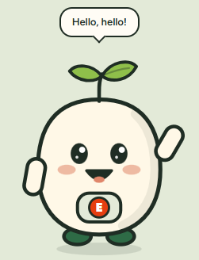

<div align="center">

# 🎨 NutriScan: Design System, Assets and Components

**Fonts, colours, images, icons, the library components we use, and every component we built.**


-8fbf4a?style=flat-square)


[← Tech stack](02-TECH-STACK.md) · [README](../../README.md) · [Architecture →](04-ARCHITECTURE.md)

</div>

---

## Contents

- [Design direction](#-design-direction)
- [Typography (fonts)](#-typography-fonts)
- [Colour palette](#-colour-palette)
- [Images and graphic assets](#-images-and-graphic-assets)
- [Icons](#-icons)
- [Components used from libraries](#-components-used-from-libraries)
- [Our component catalog](#-our-component-catalog)
- [NutriBot mascot spec](#-nutribot-mascot-spec)
- [CSS component classes](#-css-component-classes)
- [Accessibility checklist](#-accessibility-checklist)

---

## 🌿 Design direction

**"Kitchen garden."** A light, natural look: oat-paper background, forest-green ink, leaf green for actions, terracotta for warnings. It should feel like a well-designed food label, not a tech dashboard.

| ✅ We do | 🚫 We avoid |
|:--|:--|
| Flat surfaces, 1 px borders, soft paper shadows | Neon glows, blurred colour blobs, glassmorphism |
| Serif display type for warmth, clean sans for reading | Generic gradient hero sections |
| Real content (sample products, real data) | Fake "live feeds" and filler stats |
| A recognisable **Nutrition Facts** label | Novelty charts for simple numbers |
| One friendly mascot with personality | Decorative sparkles everywhere |

<p align="center">
  
</p>

---

## 🔤 Typography (fonts)

All fonts are loaded with **`next/font/google`** in `app/layout.tsx`. They're downloaded at build time and **self-hosted** with the app: no request to Google at runtime and no layout shift. Each font is exposed as a CSS variable and mapped to Tailwind in `globals.css`.

| Role | Font | Weights | CSS variable → Tailwind | Used for |
|:--|:--|:--|:--|:--|
| **Display** | [Fraunces](https://fonts.google.com/specimen/Fraunces) (variable serif) | variable (100–900) | `--font-fraunces` → `font-display` | Headlines, product names, big numbers, the `.display` class |
| **Body** | [Figtree](https://fonts.google.com/specimen/Figtree) (variable sans) | variable (300–900) | `--font-figtree` → `font-sans` (default) | All body text, buttons, forms |
| **Mono** | [Space Mono](https://fonts.google.com/specimen/Space+Mono) | 400, 700 | `--font-spacemono` → `font-mono` | Eyebrow labels, barcodes, counters, tags |

```tsx
// app/layout.tsx (excerpt)
const fraunces = Fraunces({ variable: "--font-fraunces", subsets: ["latin"] });
const figtree = Figtree({ variable: "--font-figtree", subsets: ["latin"] });
const spaceMono = Space_Mono({ variable: "--font-spacemono", subsets: ["latin"], weight: ["400", "700"] });
```

**Type scale used in practice**

| Element | Classes |
|:--|:--|
| Hero headline | `display text-[46px] sm:text-[66px] leading-[0.98]` (italic leaf-green accent word) |
| Section title | `display text-[26px]` |
| Product name | `display text-[32px] sm:text-[42px]` |
| Eyebrow label | `.eyebrow`: mono, 11 px, uppercase, `tracking-[0.14em]` |
| Body | 15–17 px Figtree, `text-muted` for secondary text |

---

## 🎨 Colour palette

Defined once as Tailwind v4 `@theme` tokens in `app/globals.css`, so every utility (`bg-leaf`, `text-clay`, `border-line`…) uses them.

| Token | Hex | Swatch | Role |
|:--|:--|:--|:--|
| `bg` | `#f4efe3` |  | Page background ("oat paper") |
| `surface` | `#fffcf5` |  | Cards, inputs |
| `raised` | `#ece5d3` |  | Hover fills, skeletons ("kraft") |
| `sage` | `#e3ead8` |  | Mascot panel, auth side panel |
| `line` / `line-strong` | `#ded4bf` / `#c9bc9f` |  | Borders and dividers |
| `fg` | `#1f2d24` |  | Main text ("forest ink") |
| `muted` / `dim` | `#4f5e53` / `#6b786e` |  | Secondary / hint text |
| `leaf` | `#2e6b46` |  | Primary actions, links, brand |
| `leaf-hot` | `#24583a` |  | Primary hover |
| `sprout` | `#8fbf4a` |  | Decoration only (mascot leaves, scan line) |
| `river` | `#2b7a66` |  | Good / low / success |
| `sun` | `#9a6514` |  | Moderate / caution |
| `clay` | `#b9502d` |  | High / errors / allergy alerts |

**Fixed colours (not themeable on purpose):**

| Use | Colours |
|:--|:--|
| Official **Nutri-Score** grades | A `#1e9e45` · B `#85bb2f` · C `#fecb02` · D `#ee8100` · E `#e63e11` |
| **FSSAI veg mark** | Veg `#1e8e3e` (green circle) · Non-veg `#7b3f1d` (brown triangle) |

> [!NOTE]
> Text colours were chosen for contrast on the light background. `leaf`, `clay`, `river`, `muted` and `sun` all reach WCAG AA (≥ 4.5:1) on `surface`. `dim` is used only for non-essential hints.

---

## 📷 Images and graphic assets

NutriScan ships **almost no image files**. Most graphics are drawn in code, which keeps the bundle small and everything crisp at any size.

| Asset | Type | Source / file | Notes |
|:--|:--|:--|:--|
| **Product photos** | Remote JPEG | `images.openfoodfacts.org` (via Open Food Facts) | Plain `` with an `onError` fallback to a 📦 icon. `next/image` is not used because photos come from several Open Food Facts hosts. |
| **Alternative / recent thumbnails** | Remote JPEG | `image_front_small_url` from search-a-licious | Same fallback behaviour. |
| **NutriBot mascot** | Inline SVG (React) | `app/components/NutriBot.tsx` | Hand-drawn shapes, animated with Framer Motion. No image file. |
| **Brand mark** (leaf + barcode bars) | CSS shapes | `app/components/Brand.tsx` | Asymmetric border-radius "leaf" with 5 bars. |
| **Favicon / app icon** | Generated PNG 32×32 | `app/icon.tsx` (`next/og` `ImageResponse`) | Same leaf mark, generated at build time. |
| `favicon.ico` | ICO | `app/favicon.ico` | Legacy fallback from the Next.js template. |
| **Paper grain texture** | Inline SVG data URI | `app/globals.css` (`body` background) | `feTurbulence` noise at 5% opacity. |
| **Veg / non-veg marks** | Inline SVG (React) | `app/components/VegBadge.tsx` | FSSAI-style square with a circle / triangle. |
| **Nutri-Score scale** | HTML/CSS | `app/components/NutriScoreBadge.tsx` | Official grade colours. |
| `public/*.svg` (`file`, `globe`, `next`, `vercel`, `window`) | SVG | `public/` | Next.js template leftovers, **not used**. Safe to delete. |
| **Documentation screenshots** | PNG | `docs/screenshots/` | Captured from the running app for these docs. |

---

## 🔣 Icons

All icons come from **[lucide-react](https://lucide.dev)** `1.55.0`. They are tree-shaken (only imported icons are bundled), 24×24 line icons sized with Tailwind (`w-4 h-4` etc.) and coloured with `currentColor`.

| Icon | Used for | | Icon | Used for |
|:--|:--|:-:|:--|:--|
| `ScanBarcode` | Open camera scanner | | `History` | Recent searches |
| `ScanLine` | "Check this one", empty scan log | | `Trophy` | Leaderboard |
| `ArrowRight` / `ArrowLeft` | Submit / Back to home | | `ArrowUpRight` | External / "more" links |
| `X` | Close, clear, remove | | `Trash2` | Clear all recents |
| `Check` / `BadgeCheck` | Rules met, "already a top pick" | | `CircleAlert` / `AlertCircle` | Warnings, errors |
| `TriangleAlert` | Allergens | | `ShieldAlert` | Personal "For you" alerts |
| `Info` | Neutral findings | | `Sparkles` | AI estimate, discovery reward |
| `Package` | Missing product photo | | `UserRound` | Profile tab, personal note |
| `Camera` / `ImageUp` | Scanner tabs | | `RefreshCw` / `Loader2` | Loading / refresh |
| `Eye` / `EyeOff` | Show / hide password | | `LogIn` / `LogOut` | Sign in / out |
| `LayoutDashboard` / `Settings` | Account menu | | `Zap` | Scout level |
| `ChevronDown` | Menu toggle | | `Heart` | "Made with love" footer |
| `Plus` | New scan | | `Salad` / `KeyRound` | Profile tabs |
| `AlertTriangle` | Username taken / invalid | | `Lock` | Update password button |

*(37 distinct icons in total.)*

---

## 📦 Components used from libraries

<details open>
<summary><b>Next.js (<code>next</code> 16.4)</b></summary>

| API / component | Import | Where | Purpose |
|:--|:--|:--|:--|
| `Link` | `next/link` | header, footer, auth pages, back buttons | Client-side navigation with prefetching |
| `useRouter`, `usePathname` | `next/navigation` | `Header`, `AuthGuard`, login/register | Redirects after sign-in/out, `?next=` handling |
| `Fraunces`, `Figtree`, `Space_Mono` | `next/font/google` | `app/layout.tsx` | Self-hosted fonts |
| `ImageResponse` | `next/og` | `app/icon.tsx` | Generated favicon |
| `Metadata`, `Viewport` | `next` (types) | `app/layout.tsx` | Title, description, theme colour |
| `instant` route config | `export const instant` | `app/dashboard/page.tsx`, `app/profile/page.tsx` | Opt gated pages out of instant-navigation validation |

</details>

<details open>
<summary><b>Framer Motion (<code>framer-motion</code> 14.1)</b></summary>

| API | Where | Purpose |
|:--|:--|:--|
| `motion.div / .article / .p` | `ProductCard`, modals, home page | Enter/exit transitions |
| `motion.g / .path / .ellipse / .text / .circle` | `NutriBot` | Animating SVG body parts (arms, sprout, eyes, hearts) |
| `AnimatePresence` | home page, `NutriBot`, speech bubble | Exit animations and `mode="wait"` swaps |
| `useMotionValue` + `useSpring` | `NutriBot` | Eyes that smoothly follow the cursor |
| `useReducedMotion` | `NutriBot` | Respects the OS "reduce motion" setting |
| `drag`, `dragSnapToOrigin`, `onTap` | `NutriBot` | Drag the mascot; tap for tricks |
| keyframe arrays + `repeat` / `repeatDelay` | `NutriBot`, `HealthMeter` | Hops, shivers, waves; animated bars |

</details>

<details open>
<summary><b>html5-qrcode 2.3.8</b></summary>

| API | Where | Purpose |
|:--|:--|:--|
| `new Html5Qrcode(elementId, { formatsToSupport })` | `BarcodeScannerModal` | Camera and file decoders |
| `Html5QrcodeSupportedFormats` (EAN-13, EAN-8, UPC-A, UPC-E, Code-128) | `BarcodeScannerModal` | Restrict to retail barcodes |
| `.start({ facingMode: 'environment' }, { fps: 10, qrbox })` | `BarcodeScannerModal` | Live camera (back camera on phones) |
| `.scanFile(file)` | `BarcodeScannerModal` | Read a barcode from an uploaded photo |
| `.stop()` / `.clear()` | `BarcodeScannerModal` | Release the camera on close |

</details>

<details open>
<summary><b>React 19</b></summary>

| API | Where | Purpose |
|:--|:--|:--|
| `useSyncExternalStore` | `lib/auth.ts` (`useSession`), `lib/recent.ts` (`useRecentSearches`), `AuthGuard` | Subscribe to localStorage-backed stores across components and tabs |
| `useState`, `useEffect`, `useRef` | everywhere | Local state, timers, focus management |
| `AbortController` (Web API) | `ProductCard` | Cancel a stale insights request when switching product |

</details>

---

## 🧱 Our component catalog

All in `app/components/` unless noted. ✅ = rendered by a page, 💤 = present but unused.

### Layout and navigation

| Component | Status | Purpose | Key props |
|:--|:-:|:--|:--|
| `Header` | ✅ | Sticky top bar: logo, **Recent** (with count), Leaderboard, account menu / Sign in | `onPickRecent?(barcode)` |
| `Footer` | ✅ | Links, credits, data source | none |
| `Brand` / `BrandMark` | ✅ | Leaf logo + "nutri**scan**" wordmark | `size` |
| `AuthShell` | ✅ | Two-column layout for sign-in / sign-up with NutriBot | `eyebrow`, `title`, `subtitle`, `footer` |
| `AuthGuard` | ✅ | Renders children only when signed in; otherwise redirects to `/login?next=…` | `children` |

### Scanning

| Component | Status | Purpose | Key props |
|:--|:-:|:--|:--|
| `BarcodeSearchBar` | ✅ | Barcode input with camera button, **Clear** and **Check it**; length validation | `barcode`, `onSearch`, `onOpenScannerModal`, `showClear`, `onClear`, `loading` |
| `BarcodeScannerModal` | ✅ | Camera / photo-upload barcode reader | `isOpen`, `onClose`, `onScanSuccess` |
| `RecentSearchesModal` | ✅ | All recent products with **All / Veg / Non-veg** filters, remove, clear all | `isOpen`, `onClose`, `onPick` |

### Results

| Component | Status | Purpose | Key props |
|:--|:-:|:--|:--|
| `ProductCard` | ✅ | The whole result: identity, verdict, analysis, daily impact, ingredients, nutrition label, swaps. Fetches insights. | `product`, `signedIn`, `onScanBarcode` |
| `ProductInsights` | ✅ | "NutriBot's take": summary, Watch out / Good stuff, personal alerts | `insights`, `loading`, `error`, `signedIn` |
| `ProductAlternatives` | ✅ | Better-rated swaps (tap to check) + Open Food Facts link | `alternatives`, `category`, `score`, `onPick` |
| `HealthMeter` | ✅ | Animated bars: sugar / fat / salt vs. daily limits | `sugars`, `fat`, `sodium` |
| `NutrientGrid` | ✅ | Printed-style **Nutrition Facts** label | `calories`, `sugars`, `fat`, `proteins`, `sodium` |
| `NutriScoreBadge` | ✅ | A–E scale with the active grade highlighted | `score` |
| `IngredientSection` | ✅ | Allergens + ingredients with *Plain English / As printed* toggle | `allergens`, `ingredientsText`, `simplifiedIngredients` |
| `VegBadge` / `VegMark` | ✅ | FSSAI veg / non-veg mark (full pill or symbol only) | `status`, `variant` |

### Account and fun

| Component | Status | Purpose | Key props |
|:--|:-:|:--|:--|
| `NutriBot` | ✅ | Animated mascot with moods and tricks | `mood`, `grade`, `size`, `showSpeech` |
| `LeaderboardModal` | ✅ | Top 10 scouts, refresh, Escape to close | `isOpen`, `onClose`, `currentUsername` |
| `RuleChecklist` | ✅ | Password / username rule pills | `rules` |
| `DashboardClient` (`app/dashboard/`) | ✅ | Stats, scan log with verdict + veg mark, back button | none |
| `ProfileClient` (`app/profile/`) | ✅ | Account / Diet & health / Security tabs, back button | none |
| `OnboardingModal` | 💤 | Older onboarding flow | none |
| `ScannerVisualizer3D` | 💤 | Three.js experiment | none |

---

## 🤖 NutriBot mascot spec

<p align="center">
  
</p>

A sprout-shaped character drawn in SVG (`viewBox 0 0 220 240`): pebble body, leaf sprout, big glossy eyes, blush, stubby arms, feet, and a **belly badge** showing the product's Nutri-Score.

| Input | Values | Effect |
|:--|:--|:--|
| `mood` | `idle` · `scanning` · `great` · `okay` · `yikes` · `confused` | Expression, body motion, speech line |
| `grade` | `A`–`E` or `null` | Letter on the belly badge |
| Poke (click / tap / <kbd>Enter</kbd> / <kbd>Space</kbd>) | cycles `wave → giggle → spin → wink → sneeze → dance → jump` | One-off trick + line |
| Drag | any direction | "Wheee!" face, snaps back |
| Cursor | anywhere on the page | Eyes follow (spring-smoothed) |
| Idle 30 s | n/a | Falls asleep (Zzz); any interaction wakes it |

| Mood | Face | Body | Extras | Line |
|:--|:--|:--|:--|:--|
| `idle` | open eyes, smile | gentle breathing bob | blinking | rotating tips ("Feed me a barcode!") |
| `scanning` | focused eyes, raised brow | quick bob | magnifying glass, loading dots on belly | "Reading the small print…" |
| `great` (A/B) | ^ ^ eyes, big grin | hop + arms up | floating hearts | "Ooh, a good one! Happy dance!" |
| `okay` (C/unknown) | open eyes, flat mouth | small nod | none | "Not bad. Fine in moderation." |
| `yikes` (D/E) | wide eyes, worried brows, wavy mouth | shiver | sweat drop | "Yikes… that's a treat, not a meal." |
| `confused` (error) | raised brow, tilted mouth | head tilt | "?" | "Hmm, I couldn't find that one." |

---

## 🧩 CSS component classes

Defined in `@layer components` in `app/globals.css`:

| Class | Look | Typical use |
|:--|:--|:--|
| `.panel` | Warm-white card, 1 px border, 20 px radius, soft paper shadow | Every content card |
| `.panel-raised` | Oat background, 16 px radius | Alternative cards |
| `.eyebrow` | Mono 11 px uppercase label | Section labels |
| `.display` | Fraunces semibold, tight tracking | Headings |
| `.field` / `.field-error` / `.field-ok` / `.field-label` | Inputs with leaf focus ring; red/teal states | Forms |
| `.btn-primary` / `.btn-ghost` / `.btn-danger` / `.btn-sm` | Pill buttons | Actions |
| `.chip` / `.chip-on` / `.chip-warn` | Small pills | Samples, recents, filters, allergies |
| `.tag` | Tiny mono badge using `currentColor` | Brand, verdict, "AI estimate" |
| `.notice-error` / `.notice-ok` / `.notice-warn` | Tinted callout boxes | Messages |
| `.link` | Underlined with a leaf-green decoration | Inline links |

---

## ♿ Accessibility checklist

- [x] Semantic landmarks (`header`, `main`, `nav`, `footer`, `section` with labels)
- [x] Dialogs use `role="dialog"`, `aria-modal`, `aria-labelledby` and close on <kbd>Esc</kbd>
- [x] Errors announced with `role="alert"`; NutriBot's speech uses `aria-live="polite"`
- [x] Toggle buttons expose `aria-pressed`; menus use `aria-expanded` / `role="menu"`
- [x] Meters (`HealthMeter`) expose `role="meter"` with values
- [x] Visible focus ring (`:focus-visible`) on every interactive element
- [x] `prefers-reduced-motion` honoured (global CSS + `useReducedMotion` in NutriBot)
- [x] Decorative SVGs are `aria-hidden`; icons that carry meaning have labels
- [ ] Full screen-reader audit (planned)

---

<div align="center">

[← Tech stack](02-TECH-STACK.md) · [README](../../README.md) · [Architecture →](04-ARCHITECTURE.md)

</div>
