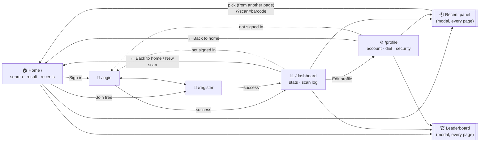
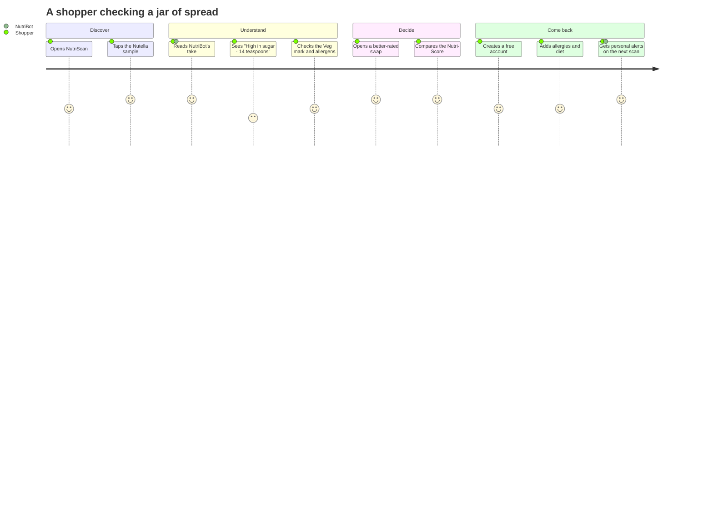
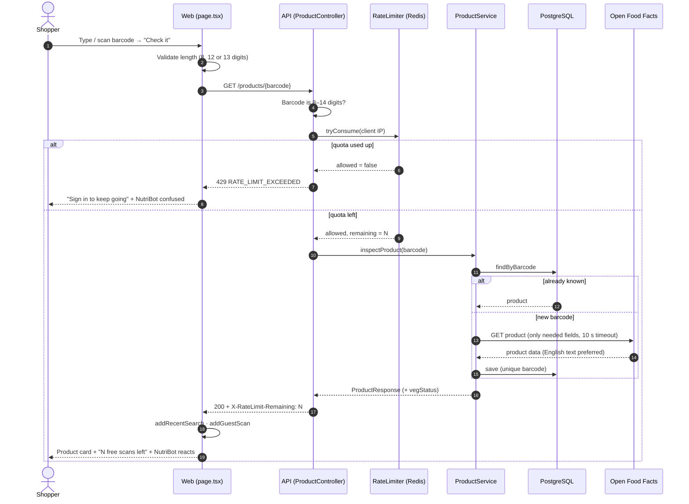
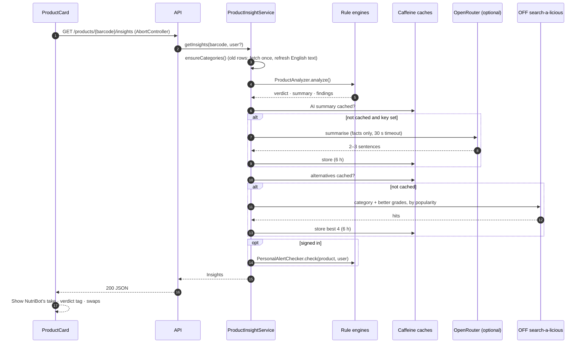
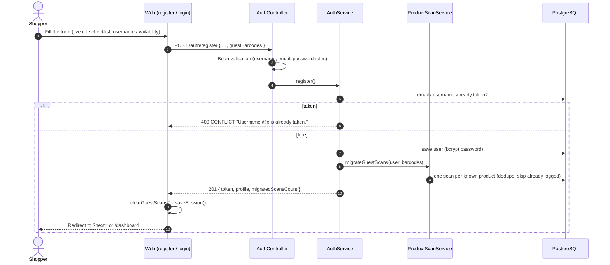
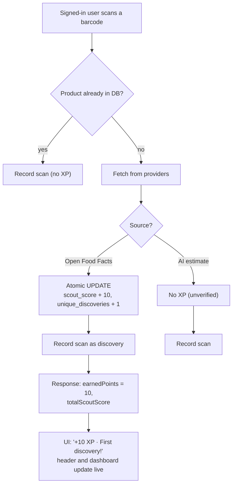
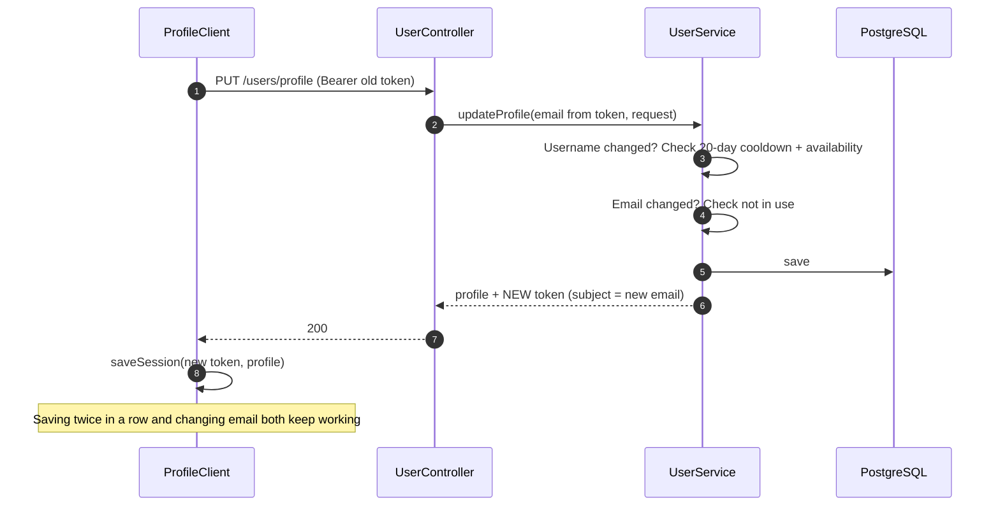
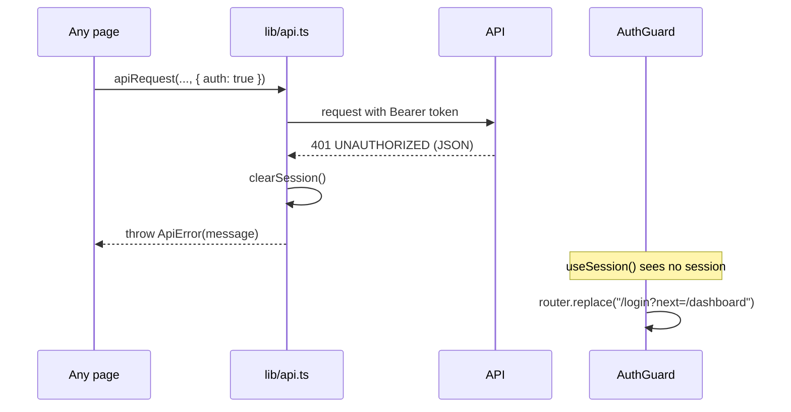
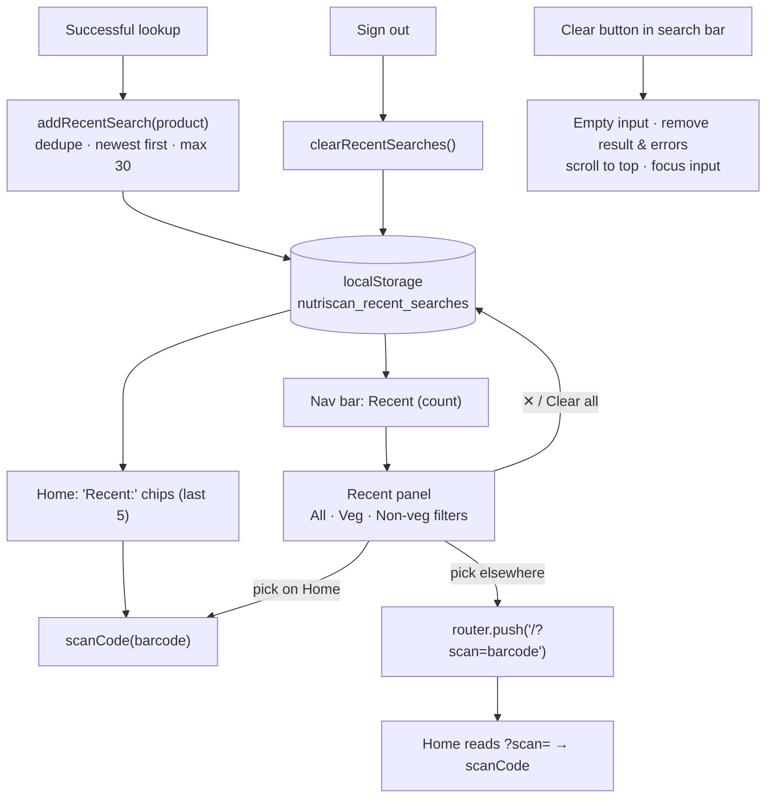
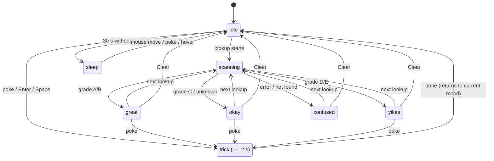

# 🔄 NutriScan: Project Flow

**Step by step: what happens when someone uses NutriScan, from the first visit to a personalised result.**

[← Architecture](04-ARCHITECTURE.md) · [README](../../README.md)

---

## Contents

1. [Page map](#1-page-map)
2. [User journey](#2-user-journey)
3. [Scan a product (guest)](#3-scan-a-product-guest)
4. [Load the analysis and swaps](#4-load-the-analysis-and-swaps)
5. [Sign up / sign in and import guest scans](#5-sign-up--sign-in-and-import-guest-scans)
6. [First discovery and XP](#6-first-discovery-and-xp)
7. [Profile update and token refresh](#7-profile-update-and-token-refresh)
8. [Session expiry](#8-session-expiry)
9. [Recent searches and Clear](#9-recent-searches-and-clear)
10. [NutriBot state machine](#10-nutribot-state-machine)
11. [What the user sees when something goes wrong](#11-what-the-user-sees-when-something-goes-wrong)

---

## 1. Page map

---

## 2. User journey

---

## 3. Scan a product (guest)

---

## 4. Load the analysis and swaps

The product card appears immediately; the analysis loads in parallel and shows a skeleton while waiting.

> [!TIP]
> Tapping a swap calls the same scan flow (section 3) with the swap's barcode and scrolls back to the top.

---

## 5. Sign up / sign in and import guest scans

Sign-in is the same flow via `POST /auth/login` (username **or** email). Five wrong passwords lock the form for 30 seconds on the client.

---

## 6. First discovery and XP

- Level = `floor(XP / 50) + 1`.
- The leaderboard shows the top 10 users with more than 0 XP.

---

## 7. Profile update and token refresh

---

## 8. Session expiry

---

## 9. Recent searches and Clear

---

## 10. NutriBot state machine

Tricks cycle in order: **wave → giggle → spin → wink → sneeze → dance → jump**. Dragging shows a "Wheee!" face and snaps back.

---

## 11. What the user sees when something goes wrong

| Situation | API | What the UI shows |
|:--|:--|:--|
| Barcode wrong length | none (checked client-side) | Inline: *"That's 5 digits. Retail barcodes have 8, 12 or 13."* |
| Not a retail barcode (e.g. letters from a QR code) | `400` | Red notice with the API message |
| Product not in any database | `404` | *"Product not registered for barcode…"* + NutriBot "?" |
| Guest used 5 free scans | `429` | Amber notice + **Sign in to keep going** button |
| Wrong password | `401` | *"Invalid username/email or password credentials."* |
| Username/email taken | `409` | Message on the form |
| Session expired | `401` | Signed out automatically → login page with `?next=` |
| API not running | network error | *"Unable to reach the NutriScan server…"* |
| Analysis service hiccup | any | Product still shows; analysis card shows an inline error |
| Camera blocked / missing | browser | Friendly message + "Upload photo" tab |
| Product photo fails to load | browser | 📦 placeholder |

---

[← Architecture](04-ARCHITECTURE.md) · [README](../../README.md)

